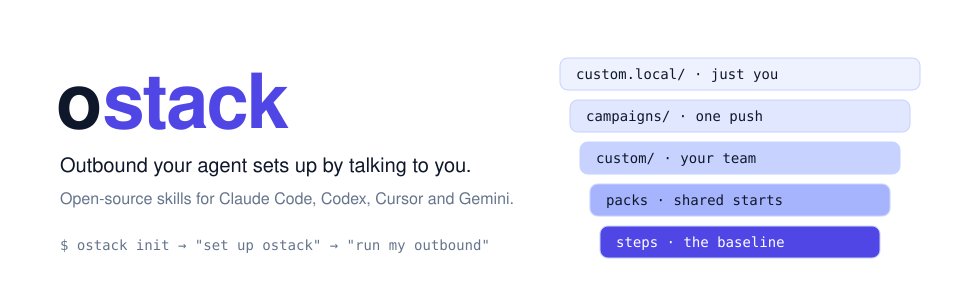
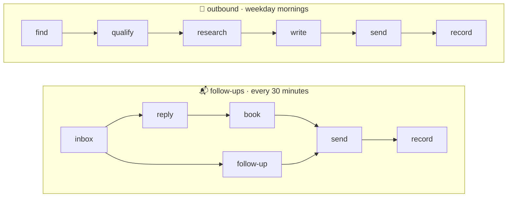
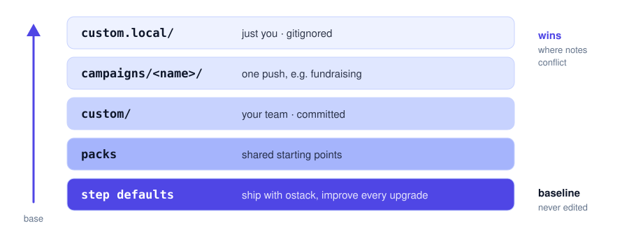
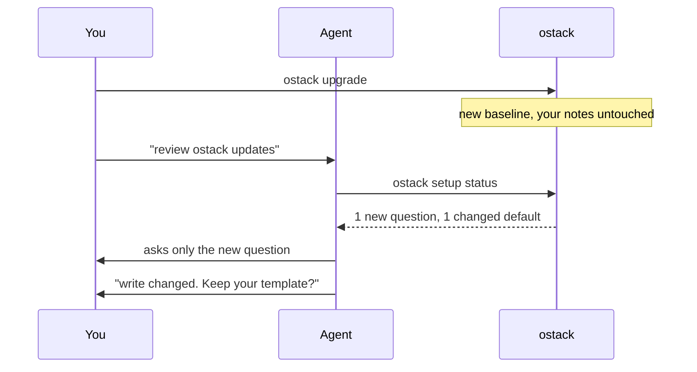

<p align="center">
  <picture>
    <source media="(prefers-color-scheme: dark)" srcset="assets/banner-dark.svg">
    
  </picture>
</p>

<p align="center">
  <a href="LICENSE"></a>
  
  
  
</p>

<p align="center">
  <b>Install it. Tell your agent how you sell. It runs outbound your way.</b><br>
  Open-source go-to-market skills from <a href="https://o11.ai">o11</a>.
</p>

---

ostack is a **baseline you shape by talking**. Your agent interviews you, writes your answers down as short plain-English notes, tests each one against your real tools, and from then on runs your workflows exactly the way you described, on a schedule in your timezone. Updates improve the baseline without ever touching what you customized.

The first module is **gtm**: it finds leads, writes, sends, follows up and books meetings. More modules will sit next to it, each adding its own workflows without moving anything you already have.

> **No hosted backend, no account, no YAML.** Your agent works through the mail, LinkedIn, calendar and CRM tools it already has. ostack brings the method, and a local ledger guarantees nobody is contacted twice.

## ⚡ Install

```bash
git clone --depth 1 https://github.com/o11-ai/ostack.git ~/.ostack/ostack
~/.ostack/ostack/setup          # Claude Code. Or: --host codex | cursor | gemini | auto
mkdir ~/ostack && cd ~/ostack && ostack init
```

Then open your agent in `~/ostack` and say **"set up ostack"**.

## 💬 Setup is a conversation

```text
you     set up ostack

agent   What do you sell, who is it for, and what should outreach lead to?
you     API monitoring for fintech teams. I want 15 minute calls with eng leads.

agent   Do you want me to keep a CRM in step with everything?
you     yes, Lightfield, through the MCP. stages are Contacted, Replied, Meeting.
agent   ✓ wrote custom/after-record.md
        ✓ created a test record in Lightfield, read it back, deleted it

agent   Do you have a template for first emails?
you     here: "hey [name], saw [recent thing]. worth 15 min?"
agent   ✓ wrote custom/write.md. Here's a real draft for Dana at Ledgerly: ...
```

Change anything later the same way: *"we sell to dentists now"*, *"stop mentioning pricing"*, *"send from my Outlook"*.

## 🧩 Skills

<table>
  <tr>
    <th width="33%">🎯 <code>ostack-outbound</code> (gtm)</th>
    <th width="33%">📬 <code>ostack-follow-ups</code> (gtm)</th>
    <th width="33%">🛠️ <code>ostack-setup</code></th>
  </tr>
  <tr>
    <td>Finds, qualifies and researches leads, then writes and sends the first message.</td>
    <td>Reads the inbox, answers replies, sends follow-ups that are due, and books meetings.</td>
    <td>Interviews you, writes and tests your notes, schedules your workflows, remembers corrections, and reviews updates.</td>
  </tr>
  <tr>
    <td><i>"run my outbound"</i><br>⏰ weekday mornings</td>
    <td><i>"did anyone reply?"</i><br>⏰ every 30 minutes in working hours</td>
    <td><i>"use my template"</i><br>⏰ whenever you want a change</td>
  </tr>
</table>

## 🔁 What a run does

Every skill is a chain of **named steps**. Each step ships with a sensible default, and before running one the agent loads your notes for it.



`record` is where your CRM, spreadsheet or Slack gets updated. `report` closes every run with a summary.

## ⏰ Runs on its own, in your timezone

Say *"schedule my workflows"*. The agent shows each workflow's suggested schedule, adjusts it to what you say, and creates it where you work:

| Where | How |
| --- | --- |
| **Claude Desktop** | A local scheduled task on your workspace folder, so it has your files and connectors |
| **Codex app** | A local automation on your workspace folder |
| **Anything else** | `ostack schedule cron install` starts Claude or Codex headless from cron |

ostack keeps the schedule (`ostack schedule list`), and each task only runs `ostack prompt <workflow>`, so tasks stay correct after upgrades. Runs never overlap, cold messages wait for your sending hours (`gtm.send_window`, weekdays 08:00-18:00 by default), and a run that catches up after your laptop slept still respects them.

## 🥞 How customization stacks

Your notes are markdown files the agent writes. They sit in layers on top of the baseline, and **the higher layer wins**:

<p align="center">
  <picture>
    <source media="(prefers-color-scheme: dark)" srcset="assets/layers-dark.svg">
    
  </picture>
</p>

| A note named… | Applies… | Example |
| --- | --- | --- |
| `custom/about.md`, `voice.md`, `learnings.md`, … | as context for every module | *"Never mention pricing."* |
| `custom/gtm/write.md` | whenever that gtm step runs | *"Always use this template: …"* |
| `custom/gtm/before-send.md` / `after-record.md` | right before or after a step | *"Update Lightfield: stages are …"* |

<details>
<summary><b>📁 What a workspace looks like</b></summary>

```
~/ostack/
├── ostack.json            managed by the CLI: timezone, modules and their settings, schedules, setup progress
├── custom/                your team's notes
│   ├── about.md           what you do, proof, what never to claim (every module reads it)
│   ├── voice.md           how you write, real samples, signature
│   ├── learnings.md       corrections you asked the agent to remember
│   └── gtm/               notes for the gtm module
│       ├── write.md       your template
│       ├── send.md        "send from sam@ in Outlook web"
│       └── after-record.md  "keep Lightfield in step"
├── custom.local/          your personal notes (same layout)
├── campaigns/             gtm notes for individual campaigns
├── scripts/               any small scripts a customization needs (an email API, a webhook)
└── .ostack/gtm.db         gtm's ledger: every lead, message, reply and opt-out (SQLite)
```

</details>

Notes hold **only what differs** from the default, so every improvement to the rest keeps reaching you. Anything can be customized, including tools ostack has never heard of.

## 🔄 Updates that respect your changes



- **New setup questions** are the only ones asked again.
- **Changed defaults** are flagged only for steps you customized, each with a one-line summary of what changed.
- **Renamed steps** keep your notes working, and the agent tidies the file names.
- **The ledger** upgrades itself, after making a backup.

## 🛡️ Guarantees

These hold whatever your notes say, because the CLI enforces them rather than relying on the prompt:

| Guarantee | What it means |
| --- | --- |
| 🔒 **Reserve → send → receipt** | Every message is recorded with its exact text before it goes out, and with the provider's ID after. |
| 🚫 **No double sends** | An unknown outcome is checked against the real mailbox. It is never resent blindly. |
| 👤 **One person, one sequence** | Duplicates are rejected, and the per-company limit holds across campaigns. |
| ✋ **Opt-outs stick** | Bounces and opt-outs block that address permanently. |
| 💬 **Replies pause** | A human reply stops the cold sequence for that person. |
| 📏 **Hard limits** | Daily volume and the follow-up schedule are ceilings. Unfilled `{{placeholders}}` and `[template slots]` are rejected. |
| ⏱️ **One run at a time, at sensible hours** | Runs of a workflow never overlap, and cold messages wait for the send window in your timezone. |
| 🧯 **No accidental writes** | Unknown flags are refused, imports can be previewed with `--dry-run`, and only never-contacted leads can be removed. |

<details>
<summary><b>⌨️ CLI reference</b></summary>

Every command prints JSON for the agent. `ostack help` lists them all. The ones you might run yourself:

| Command | Does |
| --- | --- |
| `ostack doctor` | Checks the install, the workspace, your customizations and schedules |
| `ostack modules list` | Modules you can enable, and their workflows |
| `ostack schedule list` | Each workflow's schedule in your timezone, and where it is installed |
| `ostack schedule set gtm/outbound --at 07:50` | Run outbound at 07:50 on weekdays |
| `ostack context [step]` | Exactly what the agent will read, overall or for one step (`--files` for just the note names) |
| `ostack settings show` | Timezone, and each module's settings |
| `ostack settings set gtm.follow_up_days 2,5` | Two follow-ups: 2 days after the first message, then 5 days later |
| `ostack packs list` | Shared starting points to install |
| `ostack gtm status` | Lead counts and today's budget |
| `ostack gtm leads add --input-file leads.csv --dry-run` | Preview an import |
| `ostack gtm suppress --email <x> --reason <why>` | Never contact someone again |
| `ostack upgrade` | Pulls the latest baseline |

Commands from before modules (`ostack status`, `ostack due`, …) still work and mean the gtm ones.

</details>

<details>
<summary><b>⬆️ Upgrading from 0.3 or earlier</b></summary>

`ostack upgrade`, then tell your agent "review ostack updates". Everything moves into the gtm module the first time any command runs: settings and answers, and `.ostack/ledger.db` becomes `.ostack/gtm.db`. Your notes keep working where they are, and the review offers to move step notes such as `custom/write.md` into `custom/gtm/`. The skills are renamed `ostack-outbound` and `ostack-follow-ups`; old links are removed for you.

If you cloned ostack to `~/ostack` before, it keeps working there. Only new installs use `~/.ostack/ostack`, so `~/ostack` is free for your workspace.

</details>

<details>
<summary><b>⬆️ Upgrading from 0.1</b></summary>

0.1 used `playbooks/` and `ostack.yaml`. To move a 0.1 workspace:
- Run `ostack init` in the same folder, then say "set up ostack". The agent can read your old playbook files to answer most questions.
- Your ledger migrates automatically, and old leads keep their playbook name as their campaign.

</details>

## ⚖️ Responsible use

You are responsible for following the law where you and your recipients are (CAN-SPAM, GDPR, CASL and others) and each platform's terms, including LinkedIn's. ostack starts in **draft mode**. Keep volumes low, honor every opt-out, and only send what you would send by hand.

## 🧑‍💻 Contributing

```bash
bun test ./tests
bun run src/cli.ts help
```

- **Core** (setup, notes, packs, schedules) lives in `skills/` and `src/`; each **module** lives in `modules/<id>/` with a `module.md` manifest (its workflows and their default schedules), `skills/`, `steps/`, `packs/` and `questions.md`, plus any code in `src/modules/<id>/`. A new module never needs to move anything else.
- **Step ids and setup-question ids are the stable surface** that notes attach to:
  - Rename a step only by listing the old name in `renamed_from` in its frontmatter.
  - Bump a step's `changed` version when its default changes meaningfully, and say what changed in `change`.
- **New setup questions** go in the module's `questions.md` (or [core](skills/ostack-setup/references/questions.md)) with a `Since` version.
- **Test skill changes with a real agent** in [`evals/agent-sandbox`](evals/agent-sandbox): a sandboxed mailbox, CRM, calendar and web, so a small model can run setup, outbound and follow-ups end to end while you read where it got lost.
- **New packs** in `modules/gtm/packs/` are very welcome, and so are new modules. Recruiting agencies, dev tools, local services: all of it.

<p align="center"><sub>MIT · built by <a href="https://o11.ai">o11</a></sub></p>
