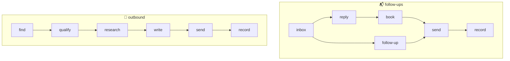
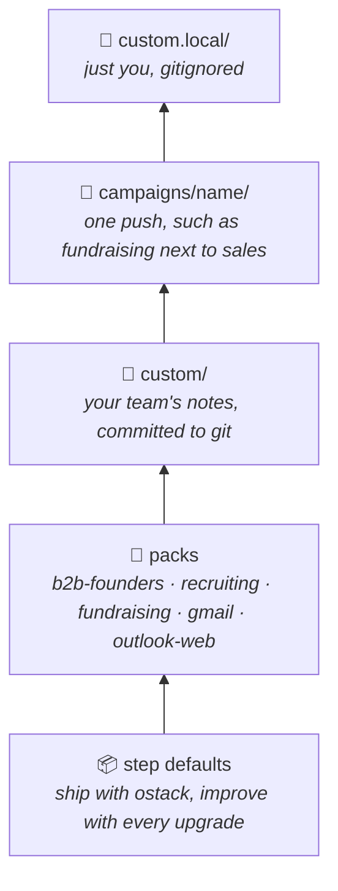
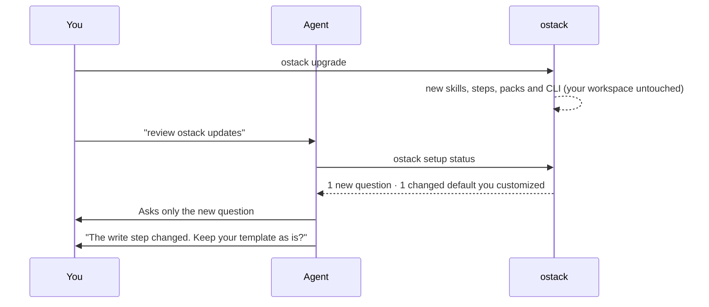

<p align="center">
  <picture>
    <source media="(prefers-color-scheme: dark)" srcset="assets/banner-dark.svg">
    
  </picture>
</p>

<p align="center">
  <a href="LICENSE"></a>
  
  
  
</p>

<p align="center">
  <b>Install it. Tell your agent how you sell. It runs outbound your way.</b><br>
  Open-source go-to-market skills from <a href="https://o11.ai">o11</a>.
</p>

---

ostack is a **baseline you shape by talking**. Your agent interviews you, writes your answers down as short plain-English notes, tests each one against your real tools, and from then on finds leads, writes, sends, follows up and books meetings exactly the way you described. Updates improve the baseline without ever touching what you customized.

> **No hosted backend, no account, no YAML.** Your agent works through the mail, LinkedIn, calendar and CRM tools it already has. ostack brings the method, and a local ledger guarantees nobody is contacted twice.

## ⚡ Install

```bash
git clone --depth 1 https://github.com/o11-ai/ostack.git ~/ostack
~/ostack/setup                  # Claude Code. Or: --host codex | cursor | gemini | auto
mkdir ~/gtm && cd ~/gtm && ostack init
```

Then open your agent in `~/gtm` and say **"set up ostack"**.

## 💬 Setup is a conversation

```text
you     set up ostack

agent   What do you sell, who is it for, and what should outreach lead to?
you     API monitoring for fintech teams. I want 15 minute calls with eng leads.

agent   Do you want me to keep a CRM in step with everything?
you     yes, Lightfield, through the MCP. stages are Contacted, Replied, Meeting.
agent   ✓ wrote custom/after-record.md
        ✓ created a test record in Lightfield, read it back, deleted it

agent   Do you have a template for first emails?
you     here: "hey [name], saw [recent thing]. worth 15 min?"
agent   ✓ wrote custom/write.md. Here's a real draft for Dana at Ledgerly: ...
```

Change anything later the same way: *"we sell to dentists now"*, *"stop mentioning pricing"*, *"send from my Outlook"*.

## 🧩 Three skills

<table>
  <tr>
    <th width="33%">🎯 <code>outbound</code></th>
    <th width="33%">📬 <code>follow-ups</code></th>
    <th width="33%">🛠️ <code>ostack-setup</code></th>
  </tr>
  <tr>
    <td>Finds, qualifies and researches leads, then writes and sends the first message.</td>
    <td>Reads the inbox, answers replies, sends follow-ups that are due, and books meetings.</td>
    <td>Interviews you, writes and tests your notes, remembers corrections, and reviews updates.</td>
  </tr>
  <tr>
    <td><i>"run my outbound"</i><br>⏰ weekday mornings</td>
    <td><i>"did anyone reply?"</i><br>⏰ hourly</td>
    <td><i>"use my template"</i><br>⏰ whenever you want a change</td>
  </tr>
</table>

## 🔁 What a run does

Every skill is a chain of **named steps**. Each step ships with a sensible default, and before running one the agent loads your notes for it.



`record` is where your CRM, spreadsheet or Slack gets updated. `report` closes every run with a summary.

## 🥞 How customization stacks

Your notes are markdown files the agent writes. They sit in layers on top of the baseline, and **the higher layer wins**:



| A note named… | Applies… | Example |
| --- | --- | --- |
| `write.md` | whenever that step runs | *"Always use this template: …"* |
| `before-send.md` / `after-record.md` | right before or after a step | *"Update Lightfield: stages are …"* |
| anything else (`about.md`, `voice.md`, `learnings.md`) | as context for every run | *"Never mention pricing."* |

<details>
<summary><b>📁 What a workspace looks like</b></summary>

```
~/gtm/
├── ostack.json          managed by the CLI: mode, limits, packs, which setup questions were asked
├── custom/              your team's notes
│   ├── about.md         what you sell, the one ask, proof, what never to claim
│   ├── voice.md         how you write, real samples, signature
│   ├── write.md         your template
│   ├── send.md          "send from sam@ in Outlook web"
│   ├── after-record.md  "keep Lightfield in step"
│   └── learnings.md     corrections you asked the agent to remember
├── custom.local/        your personal notes
├── campaigns/           notes for individual campaigns
├── scripts/             any small scripts a customization needs (an email API, a webhook)
└── .ostack/ledger.db    every lead, message, reply and opt-out (SQLite)
```

</details>

Notes hold **only what differs** from the default, so every improvement to the rest keeps reaching you. Anything can be customized, including tools ostack has never heard of.

## 🔄 Updates that respect your changes



- **New setup questions** are the only ones asked again.
- **Changed defaults** are flagged only for steps you customized.
- **Renamed steps** keep your notes working, and the agent tidies the file names.
- **The ledger** upgrades itself, after making a backup.

## 🛡️ Guarantees

These hold whatever your notes say, because the CLI enforces them rather than relying on the prompt:

| | |
| --- | --- |
| 🔒 **Reserve → send → receipt** | Every message is recorded with its exact text before it goes out, and with the provider's ID after. |
| 🚫 **No double sends** | An unknown outcome is checked against the real mailbox. It is never resent blindly. |
| 👤 **One person, one sequence** | Duplicates are rejected, and the per-company limit holds across campaigns. |
| ✋ **Opt-outs stick** | Bounces and opt-outs block that address permanently. |
| 💬 **Replies pause** | A human reply stops the cold sequence for that person. |
| 📏 **Hard limits** | Daily volume and the maximum number of touches per person are ceilings. Unfilled `{{placeholders}}` are rejected. |

<details>
<summary><b>⌨️ CLI reference</b></summary>

Every command prints JSON for the agent. `ostack help` lists them all. The ones you might run yourself:

| Command | Does |
| --- | --- |
| `ostack doctor` | Checks the install, the workspace and your customizations |
| `ostack status` | Lead counts and today's budget |
| `ostack context [step]` | Exactly what the agent will read, overall or for one step |
| `ostack settings show` | Mode (draft or send) and limits |
| `ostack packs list` | Shared starting points to install |
| `ostack leads list` | Your leads |
| `ostack suppress --email <x> --reason <why>` | Never contact someone again |
| `ostack upgrade` | Pulls the latest baseline |

</details>

<details>
<summary><b>⬆️ Upgrading from 0.1</b></summary>

0.1 used `playbooks/` and `ostack.yaml`. To move a 0.1 workspace:
- Run `ostack init` in the same folder, then say "set up ostack". The agent can read your old playbook files to answer most questions.
- Your ledger migrates automatically, and old leads keep their playbook name as their campaign.

</details>

## ⚖️ Responsible use

You are responsible for following the law where you and your recipients are (CAN-SPAM, GDPR, CASL and others) and each platform's terms, including LinkedIn's. ostack starts in **draft mode**. Keep volumes low, honor every opt-out, and only send what you would send by hand.

## 🧑‍💻 Contributing

```bash
bun test ./tests
bun run src/cli.ts help
```

- **Skills** live in `skills/` and **step defaults** in `steps/`, all plain Markdown.
- **Step ids and setup-question ids are the stable surface** that notes attach to:
  - Rename a step only by listing the old name in `renamed_from` in its frontmatter.
  - Bump a step's `changed` version when its default changes meaningfully.
- **New setup questions** go in [`questions.md`](skills/ostack-setup/references/questions.md) with a `Since` version.
- **New packs** in `packs/` are very welcome. Recruiting agencies, dev tools, local services: all of it.

<p align="center"><sub>MIT · built by <a href="https://o11.ai">o11</a></sub></p>
